# Batching several sequences

Siphon serves one sequence at a time. This note describes how it runs up to 32 sequences together with plain decode, reusing the verify pass's multi-row kernels, and how the server schedules them. [engine.md](engine.md) describes the verify pass this builds on.

## Goal and exactness

A batched step runs one row for each of up to 32 sequences. Every sequence must get exactly the tokens it would get if it were served alone.

The verify pass already gives each row the same logits, bit for bit, as a verify of that row alone at its position, whatever the other rows hold. A batched step reuses those kernels and gives each row its own caches and position, so a batched row equals a one-row verify of its sequence. A sequence decoded in a batch therefore emits `greedy_by_verify`'s tokens: the tokens of greedy decoding through one-row verifies. Speculation without `--fallback` emits the same tokens. So a request gets the same output whether it runs alone with speculation, in a batch, or switches between the two mid-generation.

Sampling keeps this. A sampled token depends only on the row's logits, the request's seed and the token's position, and speculation keeps a draft only when it equals the token the target draws at that position ([engine.md](engine.md#sampling)). A request with a seed therefore gets the same tokens alone, in a batch, or switching between the two. Each batched row samples with its own request's settings (`Model::step_batch_sampled`).

Plain decode (`Model::step`) sums in other orders, so its output differs from both after a near-tie. Batching does not use it. With `--fallback` the speculator takes plain steps, and its output was already allowed to differ between runs.

The first token after a prompt comes from the prefill's logits in every case. Prefill must use the same chunk boundaries as when served alone (chunks of `DEFAULT_PREFILL_CHUNK` from position 0), since its kernels are not row-invariant.

## State per sequence

A sequence keeps, for each of the 48 layer visits:

| State | Size |
| --- | --- |
| Global KV cache (8 visits) | 16 KiB per position with `--kv fp8`, 32 KiB with BF16, 9 KiB with NVFP4, 10.75 KiB mixed |
| Sliding ring (40 visits) | 1,024 slots, 160 MiB in all, BF16 |
| Conv states: keys, values, post-attention, post-MLP | 3 rows each, 3.7 MB in all, F32 |

plus its position and the next token to feed. The draft's state (its caches, rings, tap tail and shortlist notes) belongs only to the sequence that speculates.

The model keeps sequence slots. Slot 0 is the model's existing state, which `Model::step`, `prefill` and the verify pass use as before. Slots 1 to N-1 each own the same set of caches in separate allocations. Kernels reach a slot's caches through device tables of pointers, so nothing assumes the slots are contiguous.

## Memory: one pool of pages

Every slot reserves virtual addresses for the whole context of its global KV caches and of its sliding rings, with `cuMemAddressReserve`, which takes no memory. Physical memory comes from one pool of pages made once with `cuMemCreate` (`siphon_cuda::vmm`). A page is the allocation granularity, 2 MiB on the RTX 5090 and the RTX PRO 6000 Blackwell, which holds 2,048 positions of one FP8 global cache's keys or values, the default prefill chunk and the prefix cache's unit. A slot maps pages (`cuMemMap`, `cuMemSetAccess`, then zeroes them on the stream) as its sequence grows, a chunk of 2,048 positions at a time. It keeps them after its request ends and when it takes another sequence, which then maps none, until the pool needs them. The addresses never move, so the attention kernels, the batched step's pointer tables and every CUDA graph run unchanged on whatever pages back them.

The model maps what each step, prefill chunk, verify pass and batched step writes before it runs (`Model::map_slot`), so a caller cannot touch an unmapped position. A slot's rings take their pages when it first holds a sequence: 80 with BF16 rings, 40 with the FP8 rings of a quantized cache, whose 1 MiB key and value buffers share a page (one reservation holds a ring's keys, then its values). The draft's global caches, one set for the sequence that speculates, map from the same pool. Moving a sequence into slot 0 to speculate maps its pages there instead of copying them (`Model::transfer_slot`). The cache counts and each cache's bytes per position come from the model and the KV format, and each key and value buffer maps its own pages. An NVFP4 buffer takes 576 bytes per position with its scales, so 2,048 positions fill 1.13 MiB and a page holds about 3,640 positions; `--kv mixed` maps its two FP8 caches and six NVFP4 caches each at its own rate.

| Measured on an RTX PRO 6000 Blackwell Workstation Edition | |
| --- | --- |
| Granularity, minimum and recommended | 2 MiB |
| Creating a page | 28 µs |
| Mapping, granting access to and zeroing a chunk of the 16 FP8 caches (16 pages) | 1.73 ms |
| Unmapping a chunk | 0.80 ms, without waiting for queued work |
| Copies through mapped pages | 1,420 GB/s both ways |

A decoding sequence maps a chunk every 2,048 tokens, 1.7 ms against about 8 s of steps. `bench` decodes as fast with pooled caches as with allocated ones: 2.788 against 2.789 ms per step at 0 positions, 3.272 against 3.276 at 32,768, 4.283 against 4.291 at 131,072 and 5.959 against 5.968 at 300,000, within 0.15% (two alternating runs each in one hold). `smallm verify --hash 1` gives the same logits hashes at widths 1, 3 and 8 for the build before this change, this build with allocated caches and this build pooled.

The planner counts the weights, the fixed buffers and each slot's conv states, then gives the rest to the pool. `--context` is the positions the pool holds over every running request together, up to `--streams` times the model's 1,048,576 per-request limit (each individual request remains capped at 1,048,576). The pool also holds one request's rings and its prefix cache entry's copies of them. `--streams` is the most requests that run at once; past the first, each costs its conv states, batch rows, graph and prefix cache entry's conv copies, about 20 MiB. The pool's page tables and copies take 64 MiB more (`POOL_RUNTIME_BYTES`). With FP8 weights and caches, 30.45 GiB free on a 32 GB card and the default 0.25 GiB margin, `siphon plan` gives one request 661,504 positions with `--streams 1`, 655,360 with 4, 651,264 with 8, 641,024 with 16 and 622,592 with 32. With a fixed cache per stream, `--streams 1` gave 657,408 and 4 streams 161,792 each. `--vision` adds the tower and its buffers outside the pool ([server.md](server.md#images)): 622,592 positions with `--streams 1`. With `--kv mixed` the pool holds 933,888 positions with `--streams 1` and 923,648 with 4, against 927,744 and 4 streams of 237,568 with fixed caches; `--kv nvfp4` reaches the model's 1,048,576 at `--streams 1` either way.

The server's scheduler (`crates/siphon-serve/src/engine.rs`) goes by pages:

- It starts every waiting request that fits: a free slot, and room for its prompt, one chunk more, its rings and its entry's copies, beside what the running requests still prefill. Without a host tier it counts every position the request may reach instead, so that a running request never lacks room.
- A request that runs alone in slot 0 starts with the same room, its prompt and one chunk more, and takes another chunk before a speculation round would write past what it holds (`Speculator::generate_with_room`). It never takes the pages of its own entry or of the draft, which it speculates with. A reply that the pool cannot hold further, after every other entry has gone, ends there with `length`, as at its token limit; its entry stays.
- Requests that waited past 20 s go first in arrival order, then requests that were swapped out, then the rest from the shortest prompt. Prefill takes one chunk per turn of the request with the fewest prompt tokens left, so a short request arriving during a long prefill starts at once.
- When a request does not fit, idle slots give back the pages their prefix cache entries do not need (past the entry and their rings), then the copies of entries no longer live, then the least recently used entries with their pages (their host tier copies stay), then the draft's pages if it follows nobody. A lone request whose entry holds the draft's state does not let the draft's pages go, since its entry's draft state lies in them, and a rebuild on an idle server stops before it would drop an entry.
- When the running requests still need more pages than the pool has, they take turns through the host tier: one is swapped out (`Speculator::park`), the others run, and it comes back (`Speculator::unpark`) when it fits or when another has had its turn. A request still prefilling goes first, since its client sees no tokens yet, then the one that has run longest since it started. A request runs at least nine times as long as swapping it out and back takes, so swapping costs at most 10% of the time, and at least 1 s.

A swapped-out sequence keeps its global caches below its position and its rings and conv states at that position in the host tier, in chunks of 2,048 positions. The whole chunks of its prompt are shared, counted by references, with the host entry that agrees with it longest, as host entries share chunks; the rest is copied. Returning copies it into any free slot, so its next tokens are the ones it would have decoded without leaving. `parked_sequences_return_exactly` in `tests/prefix.rs` swaps one sequence out after 20 batched steps, lets another take its pages, returns it to another slot and checks 10 more steps of both against sequences that never moved, token and logits; it also swaps one out mid-prefill. `transfer_moves_a_sequence_exactly` moves a sequence through three slots and checks every byte.

### Measured on an RTX 5090

`siphon serve` with FP8 weights and caches and the bundled draft, on an idle RTX 5090, under the GPU lock. A conversation of 300,010 tokens is in the prefix cache and decodes a reply of 4,000 tokens; once it streams, a request of 2,010 tokens arrives, then after it one of 40,010 tokens, each for 256 tokens. Today's main with `--streams 1` against the pool with `--streams 4 --host-cache 12`:

| | `--streams 1` | Pool, `--streams 4` |
| --- | ---: | ---: |
| 2K request: time to first token | 7.50 s | 0.14 s |
| 2K request: tok/s | 486 | 130 |
| Long request meanwhile | 490 tok/s | 122 tok/s |
| 40K request: time to first token | 2.84 s | 3.35 s |
| 40K request: tok/s | 447 | 124 |
| Long request meanwhile | 0 (finished) | 64.5 tok/s |
| Long request after both | | 393 tok/s, speculating again |
| Next turn of the long conversation: time to first token | 31.9 s | 0.90 s |

With `--streams 1` the 2K request waits for the reply to finish, then takes the only slot and its prefix cache entry, so the conversation's next turn prefills all 304,220 tokens again. In the pool the side requests start beside the reply, the reply drops to batched plain decode while they run (122 tok/s with the 2K one, 64.5 tok/s while the 40K one prefills at the decode floor), and it returns to speculation after them. The conversation keeps its pages and entry: its next turn prefills 5,212 tokens.

The largest single request: on 30.86 GiB free, with the default 0.25 GiB margin, the plan gives 680,960 positions to `--streams 1` on main, and 675,840 to the pool with `--streams 1`, 669,696 with 4 and 655,360 with 16. Both served a prompt of 630,010 tokens, planned with the earlier 0.5 GiB margin and FP8 output projections: 93.04 s of prefill on main, 93.41 s pooled at `--streams 4`.

Beside the 300,010-token conversation (2,544 pages with its rings and entry copies, 298 more for the draft, of 5,724 at `--streams 16`), 32,778-token requests of 256 tokens each take 432 pages, so six run beside it at once: sent together, all six ran without a swap, their prompts prefilling one after another at the decode floor (first tokens after 2.75 to 17.6 s) while the conversation decoded at 32.4 tok/s. Seven sent at once all ran too, but swapped two requests that were still prefilling out and back; eight swapped nine times, the long conversation once for 0.54 s. The memory check peaked at 30,972 MiB against 31,084 MiB planned with six.

### Round robin

On an RTX PRO 6000 Blackwell Workstation Edition with the pool capped at `--context 524288`, close to an RTX 5090's, `--host-cache 24`:

- Two conversations of 300,010 tokens, both in the prefix cache, each decoding 3,000 tokens, do not fit together. They took turns of about 4.7 s, the quantum for 300,000 positions, and each was swapped out 5 times: 61.8 and 66.4 tok/s, 120 tok/s together, with stalls of up to 5.10 s while the other ran. A swap out copied 187 to 196 MiB, one or two chunks of generated tokens and the rings, and shared the 146 chunks of the prompt with the host entry; it took 1 to 2 ms to queue. A swap back copied 4,859 MiB in 211 ms (24.1 GB/s) into the slot the other conversation had left, whose pages it kept. When the swapped-out slot gave its pages back to the pool first, the same copy took 443 ms, half of it mapping 2,400 pages, and the two ran 106 tok/s together.
- A conversation of 480,010 tokens decoding, and four requests of 8,202 tokens arriving at once, while the pool is full. They started after 0.78 to 3.82 s; the conversation ran at 37 tok/s meanwhile, swapped out once for 1.96 s, and the short requests were swapped out 2 times each for 1.8 to 5.7 s.

A lone request decodes in one-row batched steps while another is swapped out, 128 tok/s over its turns at 300,000 positions, rather than speculating, which ran 393 tok/s at that length on the RTX 5090 above: the draft follows one sequence, and a swap drops its state, which only a prefill of the whole sequence could rebuild.

## A batched step

A batched step of B rows runs the verify pass's code path (`Ctx::prefill_enqueue` in invariant mode) with row r taken from slot `slot[r]` at position `pos[r]`. It keeps the verify pass's schedule, its FP8 L2 prefetch and its kernels. It skips the verify's backups, acceptance and rollback, and ends with every row's logits and token, greedy or drawn with the row's sampling.

Most kernels are row-independent and run unchanged: the embedding and norms, depth attention, the multi-row dense products, the message gates, the router, the experts, the LM head and the argmax. Four places read a sequence's caches or its position:

| Step | Single-sequence chunk | Batched |
| --- | --- | --- |
| `attention_post_rows` (key and value convs, log scale) | Row r's conv window is rows r - 3 .. r of the chunk, then the state; position `start + r` | Window is the row's own state and the row; position `pos[r]`. Two new arguments, null in the verify. |
| `attention_rows` (attention and KV append) | One cache shared by every row | A new entry point: grid z is the row, each z an instance of the one-row kernel on its own cache and position, with its own partials and counters. |
| Post-attention conv and residual (inside `depth_attention_rows`) | Window from the chunk's rows | A new small kernel computes it from the row's own state into the F32 residual; depth attention then reads that residual. |
| Visit end (`moe_conv_residual_step_rows`) | Shifts the chunk's rows into one set of states | A new kernel with the same arithmetic per row, shifting each row into its own slot's four states. |

Each batched row then computes exactly the one-row verify's arithmetic:

- `attention_post_rows` treats every batched row as row 0 of its own chunk.
- The attention entry point calls the same device function with one row, so each instance has the one-row verify's 34 blocks per KV head and its 3 combining blocks. A combining block waits on a counter for the other blocks of its instance, at most 2 per KV head. The GPU starts blocks in index order with the row last, so only the instance being started can have waiting blocks whose blocks have no SM yet: at most 16, while the GPU holds hundreds of these blocks at once. Every other waiting block waits for blocks that are running.
- The post-attention conv kernel uses the same operations as the fused one, and depth attention's F32 mode reads back the same values the fused mode keeps in registers.

The kernel changes stay small for merging with the attention work:

- `attention_rows` gains a new `extern "C"` entry point and no other change.
- `attention_post_rows_bf16` gains two pointer arguments.
- Everything else is new kernels. `depth_attention_rows` is not touched.

## More than 8 rows

The verify pass takes at most 8 rows, and its kernels were built for that. A batched step of up to 32 rows widens them, each so that a row runs the instructions it runs in a one-row verify:

| Kernel | Up to 8 rows | Up to 32 rows |
| --- | --- | --- |
| Dense products (`linear_rows`) | One `m16n8k16` column tile: the rows are the 8 columns | Up to 4 column tiles, each multiplying the same weight fragments by its own 8 rows. The weights still stream once. |
| Experts (`experts_rows`) | An expert's pairs are the columns of one tile | An expert's pairs split into groups of 8, each group a task of its own. Tasks run by expert, then weight tile, then group, so the groups of one tile run on neighbouring warps and its weights come from DRAM about once. |
| Router (`moe_router_step_rows`) | One cluster of 16 blocks | One cluster per 8 rows, side by side |
| Message gates (`message_gate_rows`) | One cluster of 16 blocks per gate | One cluster per gate and 8 rows |
| Attention, convs, post-attention | One instance or grid row per row | Unchanged; the scratch holds a row's partials and counters for each row |

The tensor cores compute each column of a product separately, so a row's sums are the same in any column of any tile. Above 8 rows a prefill chunk shifts the conv states and computes the relative bias in separate kernels on slot 0's states; a batched step keeps the per-row kernels at every size. The verify pass's logits stay the same bit for bit: `smallm verify --hash 1` gives the base build's hashes at widths 1, 3 and 8 with FP8 and BF16 weights.

Three other ways were measured or ruled out:

- Several 8-row sub-steps per step: each reads every weight again, so 16 rows would take two 8-row steps and serve at most the 8-stream total. Not built.
- Up to 32 pairs per expert task in 4 column tiles, which kept the expert kernel to one task per expert tile: the kernel needed 255 registers and spilled, so it fit half the blocks per SM. At 32 rows a step took 26.1 ms against 22.2 ms with groups of 8, and groups of 16 pairs in 2 tiles took 22.5 ms.
- The prefill path's GEMMs: their tiles and FP8 input quantization depend on the chunk, so a batched row would not equal a one-row verify, and a request could not move between speculation and batching without changing its tokens.

Grouping up to 256 pairs at first used a table of 128 experts by 32 pairs in shared memory. That left room for only two blocks of the expert kernel per SM instead of three, and a one-row verify took 3.93 instead of 3.78 ms. A list of the pairs with an offset per expert keeps three.

Pointer tables: for each visit, `table[visit][row]` holds the row's key cache, value cache and four conv states. The host rewrites it only when the batch's membership changes. Positions and tokens go to the device before each step, 64 bytes.

## CUDA graphs

Each batch size B from 1 to 32 gets its own graph, captured on first use, as the verify widths do. The graph reads the tokens, the positions and the pointer tables from device buffers, so it replays for any assignment of slots to rows. Membership changes rewrite the tables and pick the graph of the new size.

## New requests join

A new request takes a free slot and is prefilled into it in chunks of 2,048 rows, one chunk per engine iteration, between the batch's decode steps. On an RTX 5090 the others wait 0.13 s for a chunk at the start of a prompt and 0.19 s at 100,000 tokens. Smaller chunks would pause them less but change the prompt's KV state, since the prefill kernels are not row-invariant, and so break exactness. They would also move the prefix cache's entries, which sit at multiples of the chunk. A request whose prefill finishes joins the next batched step with its first token.

### Decode floor

With one step per chunk, a decoding request gets one token per chunk, 6 tok/s while another request prefills 100,000 tokens on an RTX 5090. After each chunk the engine therefore runs as many batched steps as give each decoding request `--decode-floor` tokens per second, 20 by default, of the time since the last step ended. That time covers the chunk, any admissions and the steps themselves, since a chunk does not wait for the GPU on its own. The steps stop at the floor, or once they took as long as everything before them, so the prefill keeps at least half the time even where a step is too slow for the floor. Each chunk ends with a whole step, so the rate came out 1 to 2.5 tok/s above the floor. The steps change only when each sequence runs, not what it computes, so every sequence gets the same tokens at any floor.

Each extra step delays the prefill by one step's time s, so a floor R costs the prefilling request about R × s / (1 - R × s) of its prefill time. A one-row step took 4.5 ms with 100,000 positions and 6.4 ms with 300,000. Measured on an RTX 5090 with two streams of 335,872 positions: request A decodes, and request B, a 100,000-token prompt sent as token ids, arrives. A's rate counts its tokens from 0.1 s after B's arrival to B's first token. Repeated runs agreed within 0.01 s.

| Floor (tok/s) | A's rate, A at 100K | B's first token, A at 100K | A's rate, A at 300K | B's first token, A at 300K |
| --- | --- | --- | --- | --- |
| 0 | 6.1 tok/s | 7.94 s | 6.0 tok/s | 8.06 s |
| 10 | 11.9 tok/s | 8.17 s (+3%) | | |
| 20 | 22.4 tok/s | 8.60 s (+8%) | 22.3 tok/s | 9.04 s (+12%) |
| 40 | 41.6 tok/s | 9.48 s (+19%) | 41.2 tok/s | 10.49 s (+30%) |

The default of 20 gives a decoding request 3.7 times the rate of one step per chunk for 8 to 12% of the prefill time. A floor of 40 more than doubles that cost for a rate that only an agent waiting on a long reply would notice. A side request that fits in one chunk gains nothing from the floor: a 2,000-token prompt got its first token after 0.14 s at every floor, and A waited 0.13 s for that chunk.

Prefill into slot k runs the existing prefill code on that slot's caches. Prefill launches its kernels directly, not through a graph, so it can take any slot's caches.

The choices of a request with `n` choices share one prompt and differ only in their seeds. When one of them finishes its prefill, the engine copies its slot into the slots of the choices that have not started prefilling (`Model::move_slot`), before the next batched step moves it past the prompt. Each copy's slot was reset when the choice joined, and `move_slot` copies the global caches up to the prompt's end and the rings and conv states whole, so the copy holds the same bytes as its own prefill would leave. Its first token is drawn from the prefill's last logits, still in the decode buffers, with its own sampling (`Model::redraw_slot`). A draw depends only on the logits, the sampling and the position, so it is the token the choice's own prefill would draw. `tests/batch.rs` (`shared_prefill_matches_separate`) checks that copies decode the tokens and logits of separate prefills with the same seeds.

## Speculation

Two ways to combine speculation with batching:

1. One sequence speculates while it runs alone; once a second request arrives, every active sequence runs batched plain decode.
2. Batched verify: every sequence drafts, and one pass verifies each sequence's anchor and drafts.

Option 2 gives more per stream. Its attention would extend the batched entry point to several rows per instance. It also needs a draft state per slot (draft caches, tap tails and shortlists), batched draft rounds, and a width policy across sequences. That roughly doubles the work.

Recommendation: option 1. A request that arrives at an idle server takes slot 0 and speculates. When another request arrives, the speculating one stops after its current round and joins the batch from slot 0, where its caches already are. When the batch drains to one request and nothing waits, that request speculates again. Since speculation and batched steps emit the same tokens, neither switch changes its output.

## Returning to speculation

A lone request in a batch runs a one-row batched step, 3.6 ms at 10,674 tokens, against about 1.3 to 2 ms per token for speculation. To speculate again it needs two things: its caches in slot 0, whose addresses the verify graphs hold, and a draft whose state covers every position before its next token.

The draft keeps one sequence's state. Speculation stops after a round or a run of plain steps, when the draft has committed every position before the anchor. From there the draft follows the request through its batched steps (`Speculator::follow`):

- Batched steps record every row's taps, as the verify pass does (`Model::set_batch_taps`). A batched row equals a one-row verify, so these are the taps speculation would have committed.
- After each step, the speculator copies the followed row's taps into its run buffer, 18 KiB per row with the bundled draft, and commits them to the draft every 32 rows (`Speculator::keep_batched`). The run buffer is the one the fallback's plain steps use.
- When the request is left alone, the speculator commits the remaining rows and makes the request's next token the anchor (`Speculator::resume`), and the round loop continues as after a prefill. This takes 0.1 ms.

A request that never speculated, or whose draft state was dropped because another request took the draft, has no draft state. The speculator rebuilds it: it prefills the request's prompt and generated tokens with taps into a free slot and commits every chunk, as a prompt's prefill does. The request's own caches stay as the batched steps left them, so its tokens do not change. Only the draft's state comes from prefill, whose sums differ slightly from the verify pass's, which can change the drafts but never the accepted tokens.

The rebuild runs one prefill chunk per turn of the batch loop (`Speculator::start_rebuild`, `rebuild_step`), where a prompt's chunk would run, and the request decodes between the chunks as `--decode-floor` gives it steps. A request that arrives meanwhile is admitted after the chunk in flight. Since the request keeps decoding, the rebuild chases it: each step prefills up to a chunk of the tokens the request has fed so far, and once it holds them all, the draft follows the request (`Speculator::follow_rebuilt`) and the request speculates again (`Speculator::resume`). The rebuild checks before each step that nothing else used its slot or the draft (`Speculator::rebuild_live`): an admitted request may take its slot, and a request that speculates takes the draft. Then it ends, and starts again from position 0 when the request is alone once more.

When to rebuild does not depend on `max_tokens`. Agents send caps of 16,384 to 32,000 tokens and reply with 150 to 2,000, so the cap says little about the tokens left. A rebuild prefills about 20,000 positions per second on an RTX 5090, about 72 positions in the time of a one-row batched step (3.6 ms), and an RTX 4090 about 55. So the request rents before it buys: it decodes batched until its one-row steps number 1/64 of the positions the rebuild still lacks, then the rebuild runs. A short reply never pays for a rebuild, and a long one pays at most about twice the better choice. Progress that an idle rebuild of its entry made (below) counts, so a turn whose entry was half rebuilt starts sooner.

A request's reply often ends before the rebuild would pay off, which left a conversation that lost the draft's state decoding batched turn after turn. With two or more streams, once the server has been idle for 0.5 s, the longest live prefix cache entry gets the draft's state if it lacks it: the same rebuild runs one chunk at a time between looks at the queue, in a slot without an entry, and gives the entry the draft's rings at its boundary. A turn that arrives meanwhile and continues the entry's tokens continues the rebuild.

Measured on an RTX 5090 with `--streams 2`, greedy, against the blocking rebuild it replaces. A conversation of 30,605 tokens loses the draft's state to a 20-token side request. Its next turn, for 4,000 tokens, hits the cache and decodes batched, and a 20-token request arrives 1 s into it. That request answered in 0.09 s, against 1.28 s while the old rebuild ran for 2.05 s. The turn took 10.1 s against 8.9 s: it decoded 487 batched steps before its rebuild started. After another side request and 8 s idle, the next turn speculated its 256 tokens at 435 tok/s from its first token, against 272 tok/s batched, since its cap left too few tokens for the old rule to rebuild. At 44,285 tokens the old rule found no room in a pool of 131,072 positions, since it also counted a copy of the sequence into slot 0, and decoded the 4,000 tokens batched in 15.8 s; the new rebuild fit, and the turn took 10.9 s.

The request may sit in any slot. If it is not in slot 0, `Model::move_slot` copies its global caches up to its position, its rings and conv states into slot 0: 16 KiB per position with an FP8 cache plus 164 MiB, 331 MiB at 10,674 positions, as device-to-device copies on the stream.

Cost to the batch: recording the taps adds one copy kernel per tap visit, and following a row adds a 18 KiB copy per step and a 32-row commit every 32 steps. `bench --batch 1,2,8 --follow` against the same build without it, alternating in one locked hold, 96 steps, mean step:

| Context | Streams | Without | Following row 0 |
| ---: | ---: | ---: | ---: |
| 0 | 1 | 3.349, 3.345 | 3.367, 3.362 |
| 0 | 2 | 4.382, 4.384 | 4.407, 4.407 |
| 0 | 8 | 8.443, 8.450 | 8.440, 8.447 |
| 10,674 | 1 | 3.635, 3.640 | 3.652, 3.655 |
| 10,674 | 2 | 4.898, 4.898 | 4.929, 4.928 |
| 10,674 | 8 | 10.303, 10.308 | 10.286, 10.292 |

Following costs 0.015 to 0.03 ms per step at 1 and 2 streams, under 0.7%, and nothing measurable at 8.

`speculation_returns_after_batch_bundled` and `_dflash` in `tests/batch.rs` speculate, batch, and speculate again, and check every token against one-row verifies. The first sequence returns from slot 0 with its kept taps. The second returns from slot 1 after a rebuild in slot 2.

End to end, siphon-serve with `--streams 4` served three cases with the bundled draft and with DFlash 2 (`--drafter`), and every request returned the token ids it gets alone. In the first case a 600-token request speculates, a 60-token request joins for 59 batched steps, and the first speculates again. In the second, the first request reaches its 300-token limit in the batch and the second returns from slot 1 after a 33 ms rebuild at position 273. In the third, the first request leaves speculation twice. With the bundled draft, the first request's resumed speculation ran its last 265 tokens at 680 tok/s, and the same tokens of the request alone came at 693 tok/s, measured from the client. With DFlash 2 the figures were 699 and 715 tok/s.

## Throughput

The estimate before building took a batched step of B rows to cost a verify of B rows, plus the extra sequences' own KV reads (about 0.19 ms each at 10,674 tokens), plus about 0.1 ms for the separate post-attention conv kernels. That gave 434, 675 and 947 tok/s at 2, 4 and 8 streams at 10,674 tokens.

The measurements came out lower: 408, 576 and 797 tok/s. The experts explain most of the gap. A verify's rows are consecutive tokens of one text, which share experts: 8 rows touch 29 distinct experts per visit. Rows from 8 different texts touch about 50. A kernel trace at 10,674 tokens and 8 streams, also locked and alone on the GPU, showed the experts at 5.9 ms and attention at 2.1 ms of a 10.0 ms step, both close to DRAM bandwidth. That trace predates the tensor-core attention, which took 0.15 ms off a one-row verify at 10,674 tokens.

`bench --batch 1,2,3,4,6,8 --prompt <capture>`, FP8 weights and cache, on an RTX 5090, in one run under the GPU lock with no other compute process on the GPU but a 35 MiB desktop one. Each sequence's caches skip to the context, and row r feeds the `anyhow` capture's tokens from offset r / 8 of its length on, so each row routes as a different text does. The median step of 40, ms, with tok/s in all and per stream:

| Context | Plain step | One-row verify | 1 stream | 2 | 3 | 4 | 6 | 8 |
| ---: | ---: | ---: | --- | --- | --- | --- | --- | --- |
| 0 | 2.71 | 3.43 | 3.33: 300 | 4.37: 457, 229 | 5.22: 575, 192 | 6.01: 666, 166 | 7.30: 823, 137 | 8.24: 971, 121 |
| 4,096 | 2.86 | 3.55 | 3.56: 281 | 4.75: 421, 210 | 5.75: 522, 174 | 6.73: 594, 149 | 8.34: 719, 120 | 9.63: 831, 104 |
| 10,674 | 2.96 | 3.65 | 3.63: 275 | 4.90: 408, 204 | 5.92: 507, 169 | 6.94: 576, 144 | 8.60: 698, 116 | 10.04: 797, 100 |
| 32,768 | 3.23 | 3.96 | 3.93: 254 | 5.37: 373, 186 | 6.64: 452, 151 | 7.79: 513, 128 | 9.80: 612, 102 | 11.72: 683, 85 |

One stream in a batch matches a one-row verify. Plain decode runs 366 tok/s and speculation 490 to 800 tok/s for one sequence. With option 1, a speculating request drops to about 200 tok/s when a second arrives, so two streams together get about what one speculating stream gets alone. From three or four streams on, batching serves more in total. A lone sequence in a batch runs about 23% slower than plain decode, the price of keeping the verify's numerics, which is why it returns to speculation.

The two separate conv kernels cost about 0.15 ms per step. Folding the post-attention conv into depth attention would save most of that, once the depth-attention work settles.

### 16 and 32 streams on an RTX PRO 6000 Blackwell Max-Q

The same benchmark up to 32 rows (`bench --batch 1,2,4,8,16,24,32`), FP8 weights and cache, on an RTX PRO 6000 Blackwell Max-Q (188 SMs, 275 W), with the other compute process on the GPU paused. Row r feeds the capture from offset (r mod 8) / 8 + (r div 8) / 32 of its length, so rows 0 to 7 feed what they fed before. The median step of 100, ms, with tok/s in all and per stream:

| Context | 1 stream | 2 | 4 | 8 | 16 | 24 | 32 |
| ---: | --- | --- | --- | --- | --- | --- | --- |
| 0 | 3.82: 262 | 5.18: 386, 193 | 7.29: 549, 137 | 10.23: 782, 98 | 14.78: 1082, 68 | 18.30: 1312, 55 | 21.17: 1512, 47 |
| 10,674 | 4.18: 239 | 5.74: 348, 174 | 8.26: 484, 121 | 12.11: 661, 83 | 18.37: 871, 54 | 23.56: 1019, 42 | 28.12: 1138, 36 |
| 32,768 | 4.44: 225 | 6.24: 320, 160 | 9.08: 440, 110 | 13.79: 580, 73 | 21.61: 740, 46 | 28.39: 845, 35 | 34.84: 918, 29 |

32 streams serve 1.93 times the 8-stream total at context 0, 1.72 times at 10,674 and 1.58 times at 32,768. The build before this change, run alternately in the same hold, took 10.24, 11.99 and 13.68 ms at 8 rows and 3.82, 4.16 and 4.41 ms at one row, within 1% of these.

A kernel trace at context 0, each kernel counted from the previous one's end, us per step:

| Operation | 8 rows | 16 rows | 24 rows | 32 rows |
| --- | ---: | ---: | ---: | ---: |
| Experts | 6,291 | 9,416 | 11,402 | 12,944 |
| Dense products and LM head | 810 | 1,172 | 1,430 | 1,950 |
| Attention | 603 | 1,117 | 1,565 | 1,998 |
| L2 prefetch | 549 | 493 | 529 | 463 |
| Message gates | 353 | 397 | 373 | 549 |
| Depth attention | 331 | 367 | 371 | 392 |
| Step span | 9,698 | 13,878 | 16,876 | 19,714 |

At the card's 1,645 GB/s, the expert kernel's time is what streaming about 48 distinct experts per visit takes at 8 rows, and about 99 at 32, of 4.5 MB each. Attention at context 0 grows with its 272 blocks per row, most of which find no keys.

Over HTTP, `siphon serve --streams 32 --context 16384` answered 32 concurrent chat requests of 512 tokens each in 13.6 s, 1,198 and 1,207 tok/s in all over two rounds, prompts and their prefill included.

## Against vLLM and SGLang on an RTX PRO 6000 Workstation Edition

Measured on an RTX PRO 6000 Blackwell Workstation Edition (188 SMs, 96 GB, 1.79 TB/s, held to 450 W, driver 620.70), every engine under the GPU lock with no other compute process on the GPU. The Max-Q numbers above do not carry over: at 32 streams and context 0 this card runs 1,910 tok/s against the Max-Q's 1,512.

### What each engine runs

| | Siphon | vLLM | SGLang |
| --- | --- | --- | --- |
| Build | this branch | 0.34.1rc1.dev191+ge4ac319d2 (nightly wheel), torch 2.14.0+cu132, FlashInfer 0.7.4 | 0.5.6.post3.dev15594+gffc106df9 (pull request 51926), torch 2.14.1+cu132 |
| Experts, layers 0 to 19 | NVFP4 weights, BF16 activations | NVFP4 × NVFP4: activations quantized per token by the four-over-six rule, Triton `tl.dot_scaled` | NVFP4 × NVFP4 through FlashInfer's SM120 CUTLASS grouped GEMMs |
| Experts, layers 20 to 23 | MXFP8 weights, BF16 activations | MXFP8 × MXFP8 | MXFP8 × MXFP8 |
| Dense projections and LM head | FP8 E4M3 copies, one scale per row | BF16, cuBLASLt | BF16 |
| Global KV cache | FP8 E4M3 | FP8 E4M3 | MXFP8 |
| Sliding KV | BF16 ring | FP8 E4M3 | MXFP8 |
| Speculation | bundled draft, for a request alone | DSpark, 7 drafts | DSpark, block of 8 |
| Batched rows | equal one-row verifies bit for bit | no such property | no such property |

vLLM ran with `--kv-cache-dtype fp8 --max-num-seqs 32 --max-model-len 40960`. SGLang's FA4 attention on SM120 rejects an E4M3 cache (query BF16, key E4M3), so it ran with `--kv-cache-dtype mxfp8`, and with `--disable-prefill-cuda-graph`, since capturing its 58 prefill graph shapes took 9 minutes for the first. Siphon ran `siphon serve --streams 32 --context 40960`.

The checkpoint's quantization config asks for NVFP4 activations on the NVFP4 experts and MXFP8 activations on the MXFP8 ones. Siphon keeps BF16 activations because NVFP4 activations double KL against the F32 captures ([engine.md](engine.md)); its prefill can run the checkpoint's formats with `--expert-activations quantized`.

### Serving throughput

One client drives every engine over the OpenAI API: greedy, `ignore_eos`, 512 tokens per request, all requests sent at once, each with its own prompt. Two prompt sets: chat requests (HumanEval+ tasks and GPQA diamond questions, alternating), and completions of 256-token excerpts of 10 Project Gutenberg books. The decode rate of a stream is its tokens after the first over the time from its first token to its last; the table gives the sum over streams, which leaves out admission. Ranges are two runs.

Chat, decode rate summed over streams:

| Engine | 1 stream | 8 | 16 | 32 |
| --- | ---: | ---: | ---: | ---: |
| Siphon | 471 to 602 | 868 to 884 | 1,227 to 1,236 | 1,690 to 1,713 |
| vLLM | 177 | 736 to 744 | 1,169 to 1,181 | 1,781 to 1,815 |
| vLLM, DSpark | 263 to 406 | 1,465 to 1,522 | 2,485 to 2,563 | 4,019 to 4,121 |
| SGLang | 163 | 712 to 722 | 1,122 to 1,133 | 1,723 to 1,757 |
| SGLang, DSpark | 277 to 378 | 1,407 to 1,437 | 2,390 to 2,428 | 3,752 to 3,935 |

Book completions, the same measure:

| Engine | 1 stream | 8 | 16 | 32 |
| --- | ---: | ---: | ---: | ---: |
| Siphon | 573 to 629 | 894 to 920 | 1,289 to 1,327 | 1,813 to 1,846 |
| vLLM | 175 | 756 to 771 | 1,222 to 1,258 | 1,914 to 1,966 |
| vLLM, DSpark | 310 to 319 | 1,573 to 1,648 | 2,538 to 2,923 | 4,483 to 4,513 |
| SGLang | 162 | 719 to 743 | 1,181 to 1,202 | 1,876 to 1,935 |
| SGLang, DSpark | 311 to 360 | 1,403 to 1,646 | 2,644 to 2,658 | 4,113 to 4,220 |

Tokens over the wall time of the whole run, chat, where SGLang with DSpark had no stalls: Siphon 457 to 581, 838 to 854, 1,166 to 1,176 and 1,564 to 1,587 tok/s at 1, 8, 16 and 32 streams; SGLang with DSpark 255 to 338, 1,068 to 1,099, 1,745 to 1,900 and 2,520 to 2,713. vLLM stalled about 6 s at the start of most runs at 8 streams and more, with and without DSpark, even after warm-up runs at every width, so its wall-time rates are lower than its decode rates suggest.

Three things set the gaps:

- Plain decode is even. On the same workload at 32 streams, a Siphon step of 32 rows takes 16.48 ms between step starts and a vLLM step 16.70 ms (kernel traces, median steps). At 8 streams Siphon's step is 8.99 ms, and vLLM's decode rate puts its step near 10.4 ms.
- Admission costs Siphon 7 to 9% at 32 streams. It prefills each new request alone, between batched steps, since prefill must keep the chunk boundaries a request has when served alone: the 32 prompts of 256 tokens reach their first token after 0.60 to 0.68 s on average, against 0.21 to 0.31 s in vLLM, which prefills them in one pass. Each of those prefills reads most of the expert weights for 256 rows.
- Speculation across streams is the large gap. vLLM and SGLang verify every stream's drafts in one pass of up to 256 rows. A 32-row step already reads about 75 of the 128 experts per visit (the expert kernel's time at the harness's 87% of the floor) and 256 rows read nearly all of them, so the extra rows cost far less than their count. DSpark more than doubles the decode rate: 2.2 to 2.4 times Siphon's on chat at 32 streams. Siphon speculates only for a request alone, where it runs about 1.6 times as fast as either engine on chat and 1.8 times on book text, by the middle of the ranges. See [What option 2 would gain](#speculation) for the costs on the Siphon side; at 16 to 32 streams they would need passes of more than 32 rows and a draft that runs every sequence in one pass.

### Prefill

One request at a time, time to the first token, tok/s:

| Engine | 8,192 tokens | 32,768 tokens |
| --- | ---: | ---: |
| Siphon over HTTP, book text | 14,895 to 14,960 | 14,321 to 14,330 |
| Siphon `bench --prefill` | 16,332 | 15,574 |
| Siphon `bench --prefill`, checkpoint formats | 28,053 | 25,329 |
| vLLM | 20,421 to 20,472 | 17,634 to 17,654 |
| SGLang | 18,082 to 18,104 | 16,246 to 16,290 |

The checkpoint-formats row is `--expert-activations quantized --prefill-dense fp8 --prefill-attention fp8`, the activation formats the other two engines run. With them `bench` prefills 37% faster than vLLM at 8,192 tokens and 43% at 32,768. `bench --prefill` feeds arbitrary token ids, whose routing reads fewer bytes than real text: in the default formats it runs 9% above the HTTP figure, so real text in the checkpoint's formats would still prefill about 25% faster than vLLM. The default trades that speed for BF16 expert activations.

### Floors and library kernels at batched-decode shapes

Up to 32 rows every product is bound by memory: at 32 rows the experts' arithmetic is 196 GFLOP per step, under 1 ms at the BF16 tensor-core rate, and the dense products and LM head 112 GFLOP. The floor below is the bytes a call must read once from DRAM at 1.79 TB/s. GPU performance counters are not available in this container, so bytes come from the shapes and, for the experts, from the routing the harness draws.

Experts. A harness calls each kernel on the same random NVFP4 weights of 128 experts, in 8 copies so every call reads its weights from DRAM, with each row routed to 8 distinct experts at random. The experts per call were 50.2, 81.8 and 110.0 at 8, 16 and 32 rows. Microseconds per call, with the share of the floor:

| Kernel | 8 rows | 16 rows | 32 rows |
| --- | ---: | ---: | ---: |
| Siphon `expert_mlp_rows` (BF16 activations) | 145.7 (86%) | 234.3 (87%) | 315.8 (87%) |
| FlashInfer SM12x, NVFP4 × BF16 | 146.1 (86%) | 242.9 (84%) | 315.2 (87%) |
| FlashInfer SM12x, NVFP4 × NVFP4 | 154.2 (82%) | 240.8 (85%) | 317.8 (87%) |
| vLLM Marlin MoE, NVFP4 × BF16 | 155.8 (81%) | 243.3 (84%) | 323.4 (85%) |
| FlashInfer b12x, NVFP4 × BF16 | 159.9 (79%) | 248.6 (82%) | 335.8 (82%) |
| FlashInfer cuTile, NVFP4 × NVFP4 | 177.4 (71%) | 262.1 (78%) | 349.3 (79%) |
| FlashInfer cuTile, NVFP4 × BF16 | 194.1 (65%) | 294.9 (69%) | 387.2 (71%) |

No library kernel beats Siphon's, and the best two tie it. The engines' own expert kernels, from kernel traces of each server at 32 streams on the book workload, per step: Siphon 10.3 ms (206 us per NVFP4 visit, 312 us per MXFP8 visit), vLLM 10.5 ms (its Triton GEMMs 10.0 ms, routing and activation quantization 0.5 ms), SGLang 11.5 ms (FlashInfer's CUTLASS NVFP4 grouped GEMMs 10.6 ms, quantization and routing 0.9 ms).

Attention, us per call:

| Attention | Floor | Siphon | FlashInfer batch decode |
| --- | --- | ---: | ---: |
| Global, FP8 cache, 32,768 keys, 8 / 16 / 32 rows | 300 / 600 / 1,200 | 336 / 666 / 1,328 | 336 / 667 / 1,319 |
| Sliding, BF16 ring of 1,024, 32 rows | 75 | 104 | 86 |

FlashInfer's kernel has no relative bias, sinks or log scaling, so it bounds what plain decode attention costs. At 8 and 16 rows its sliding test fit in L2, so only the 32-row case compares.

Dense products, us per call. Siphon's run inside the step, where the L2 prefetch has already brought the weights in; cuBLASLt's were timed with the weights in L2 ("warm") and in DRAM ("cold"):

| Product | Floor, FP8 / BF16 | Siphon FP8, 8 / 16 / 32 rows | cuBLASLt BF16 warm | cuBLASLt BF16 cold | cuBLASLt FP8 |
| --- | --- | --- | --- | --- | --- |
| Input projection, 2304 to 8600 | 11.1 / 22.1 | 7.5 / 10.1 / 18.1 | 8.2 / 8.0 / 10.2 | 26.8 / 25.6 / 28.3 | needs n divisible by 16 |
| Output projection, 3072 to 2304 | 4.0 / 7.9 | 3.9 / 6.0 / 8.8 | 5.3 / 4.9 / 5.2 | 11.3 / 11.6 / 11.5 | 13.1 to 14.2 |
| LM head, 2304 to 201,024 | 259 / 518 | 271 / 279 / 324 | | 568 / 571 / 594 | 410 / 366 / 340 |

cuBLASLt beats Siphon's input and output projections at 32 rows when the weights sit in L2. Its BF16 weights would double the prefetch's DRAM bytes, so adopting it would move that time elsewhere; the tile pairs below took part of the gap instead.

### Changes

Two changes, each leaving every result bit for bit as before (`smallm verify --hash 1` at widths 1 and 8, and `tests/batch.rs` at 5, 16 and 32 sequences):

- The batched attention launches only the split blocks a cache's slots can reach and one recent block. A 1,024-slot sliding ring fills at most 16 of the 32 split blocks, and with one row per instance the second recent block has no row, so half the blocks only waited and left.
- At 17 to 32 rows each block of the dense products takes two weight tiles and reads its inputs once for both. At 3 and 4 column tiles the inputs are 3 and 4 times the FP8 weight bytes, from L2.

`bench --batch` before and after, alternating in one locked hold, ms per step, two runs each:

| Context | Rows | Before | Attention | Attention and tile pairs |
| ---: | ---: | --- | --- | --- |
| 0 | 16 | 11.85, 11.87 | 11.75, 11.76 | 11.75, 11.78 |
| 0 | 32 | 16.33, 16.37 | 16.05, 16.10 | 15.97, 15.97 |
| 10,674 | 16 | 15.23, 15.24 | 15.12, 15.13 | 15.15, 15.16 |
| 10,674 | 32 | 23.20, 23.21 | 22.75, 22.76 | 22.65, 22.68 |
| 32,768 | 16 | 18.42, 18.42 | 18.30, 18.31 | 18.32, 18.34 |
| 32,768 | 32 | 29.72, 29.75 | 29.27, 29.28 | 29.19, 29.22 |

At 8 rows the three builds are within 0.05 ms. At 32 rows the two changes take 1.8 to 2.3% off a step.

Over HTTP, `siphon serve --streams 32` before and after, alternating, one run each per round: at 32 streams chat went from 1,586 and 1,594 tok/s in all to 1,604 and 1,612, and book completions from 1,657 and 1,667 to 1,679 and 1,688, 1.1 to 1.3%. At 8 streams the two builds were within 0.7%. Prefill, which the changes do not touch, takes part of each run.

Tried and dropped: letting each launched attention block run 2 or 4 split blocks in turn, which keeps every partial. With 4 sliding splits per block a 32-row step took 0.1 to 0.2 ms less at context 0 and the same or more at 10,674 and 32,768; grouping the global attention's splits made it slower.

### What remains

- Speculation across streams (option 2 above), at 2.2 to 2.4 times the decode rate on chat at 32 streams. It needs passes of more than 32 rows, which the dense products, expert grouping, router, attention combiners and visit-end kernels cap today, a draft that drafts every sequence in one pass, and a width policy across sequences.
- Admission: prefilling several waiting requests together would read the weights once for all of them, but would change their caches from what each gets prefilled alone.
- Prefill: with BF16 expert activations the default prefills at 58 to 61% of the speed of the checkpoint's own formats. No library kernel was needed to beat vLLM's and SGLang's prefill; the format choice decides it.
